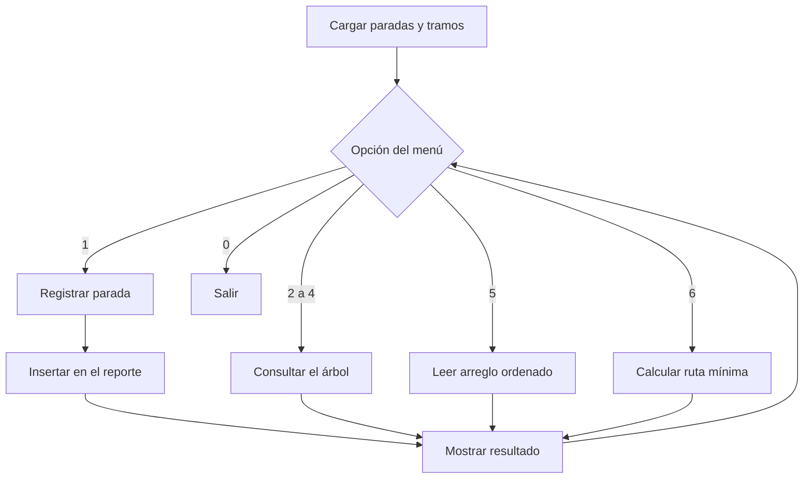
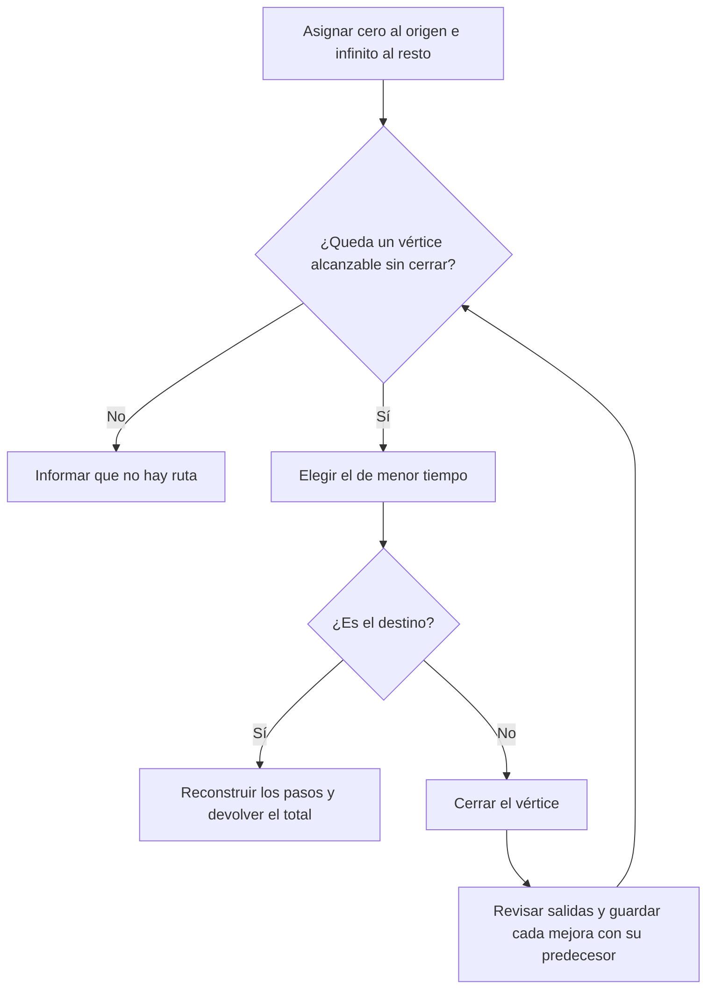
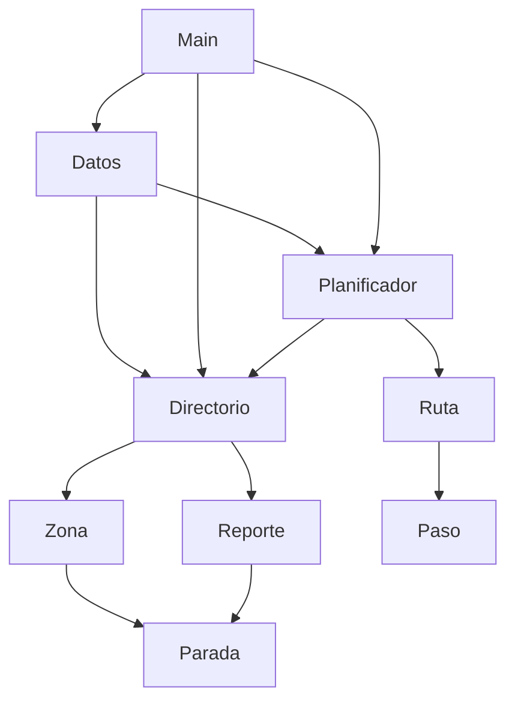
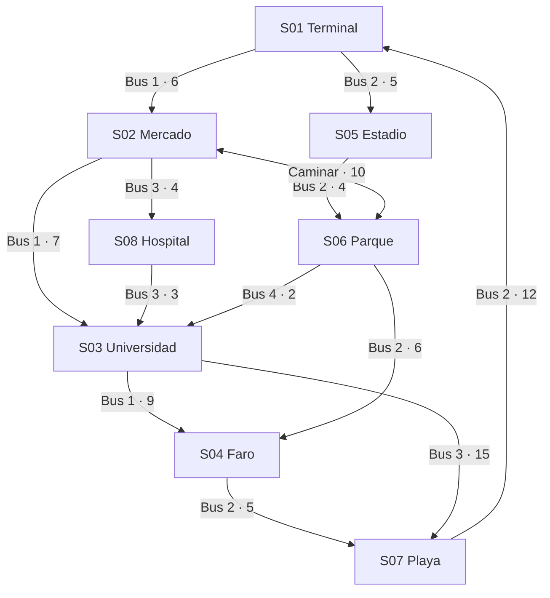

# RutaBus · Puerto Celeste

**Examen-Proyecto de Algoritmos y Estructuras de Datos**  
**Autores:** Aarón Azofeifa Bermúdez y Santiago Acuña Fernández.

Aplicación de consola en Java 17 para consultar abordajes y calcular viajes en la red de Puerto Celeste. Incluye los dos CSV del examen y una suite de pruebas JUnit 5.

## Requerimientos del sistema

Se conserva la clasificación de la parte 1.

| Módulo | Tipo | Requerimientos propuestos |
|---|---|---|
| F1. Directorio de paradas | Funcional | Agregar una parada a una zona. Listar las paradas de una zona. Obtener el total de abordajes diarios de una zona. Obtener el total de abordajes diarios de la ciudad. |
| F1 | No funcional | El nombre de la ciudad es Puerto Celeste. |
| F2. Reporte de pasajeros | Funcional | Listar las paradas en orden descendente. En caso de empate, lista por código de la parada. Paradas deben tener un código de A a Z. Reporte de abordajes diarios corre en un servidor compartido. |
| F2 | No funcional | Ciudad puede tener 1200 paradas o más. |
| F3. Planificador de viajes | Funcional | El pasajero debe de poder elegir una parada de salida y un destino. La app debe decir qué buses tomar (y si debe caminar para llegar a la parada) lo antes posible. El app debe decir cuál bus tomar. El app debe decir cuánto va a tardar el usuario en llegar a la parada. El bus solo tienen una dirección (solo circula por su carril). El usuario puede caminar en ambos sentidos. |
| F3 | No funcional | Cada zona tiene un nombre. Son 4 buses. |

## Instalación y ejecución

1. Instale un **JDK 17** y **Apache Maven 3.9**. Configure JAVA_HOME con la carpeta del JDK y agregue al PATH las carpetas bin del JDK y de Maven.
2. Descomprima el proyecto y abra una terminal en la carpeta PuertoCeleste, donde están pom.xml y datos/. Compruebe el entorno con los siguientes comandos.

   ```sh
   java -version
   mvn -version
   ```

3. Ejecute la suite y genere el JAR. La primera compilación con Maven necesita acceso a Maven Central.

   ```sh
   mvn clean package
   ```

4. Inicie la aplicación desde esa misma carpeta.

   ```sh
   java -jar target/rutabus-1.0.jar
   ```

   También puede ejecutar el JAR incluido, con Java 17 y sin instalar Maven.

   ```sh
   java -jar dist/rutabus-1.0.jar
   ```

Para ejecutar solo las pruebas use `mvn test`. El argumento opcional del JAR es la carpeta que contiene abordajes.csv y tramos.csv. En un servidor compartido se usa el mismo comando en una terminal. Cada proceso carga los CSV en su propia memoria y las altas del menú duran esa sesión.

### Uso del menú

| Opción | Entrada | Resultado |
|---|---|---|
| 1 | Código, nombre, zona y abordajes | Agrega la parada y crea su zona si es nueva. |
| 2 | Nombre de la zona, por ejemplo Norte | Muestra sus paradas en orden de alta. |
| 3 | Nombre de la zona | Suma los abordajes de sus paradas. |
| 4 | Ninguna | Muestra el total de la ciudad. |
| 5 | Ninguna | Imprime código, parada, zona y abordajes en orden de reporte. |
| 6 | Códigos de salida y destino | Muestra el medio de cada tramo, las paradas, los minutos por tramo, la llegada acumulada y el total. |
| 0 | Ninguna | Termina la sesión. |

**Ejemplo con los archivos entregados.** Seleccione 6, ingrese S01 y luego S03. Tome el Bus 2 en Terminal, pase por Estadio a los 5 minutos y baje en Parque a los 9 minutos. Tome el Bus 4 hasta Universidad. El tiempo total es de **11 minutos**. Para una caminata, consulte S06 → S02. El trayecto directo de Parque a Mercado toma **10 minutos**.

## Jerarquía de carpetas y clases

| Ubicación | Contenido |
|---|---|
| pom.xml | Configuración de Java 17, JUnit Jupiter 5, ejecución de pruebas y clase principal del JAR. |
| datos/abordajes.csv | Código, nombre, zona y abordajes de cada parada. |
| datos/tramos.csv | Medio de transporte, nombres de origen y destino y minutos. |
| src/main/java/puerto/ | Fuentes de la aplicación, descritas abajo. |
| src/test/java/puerto/ | DirectorioTest, ReporteTest, PlanificadorTest y DatosTest. |
| dist/rutabus-1.0.jar | Aplicación compilada para Java 17. |
| target/ | Maven genera aquí las clases, el JAR y los resultados de Surefire. |

| Clase | Responsabilidad |
|---|---|
| Main | Carga la red, lee el menú y presenta resultados. |
| Datos | Lee los CSV en UTF-8. Fila es la operación privada que interpreta cada registro. |
| Parada | Registro inmutable con código, nombre, zona y abordajes. |
| Directorio | Raíz del árbol de la ciudad. Agrega paradas, agrupa por zona y conserva índices estables para el grafo. |
| Zona | Nodo intermedio con nombre y arreglo de paradas hijas. Suma sus abordajes. |
| Arreglo | Almacena elementos en un arreglo redimensionable propio. Admite acceso por índice e inserción. |
| Reporte | Mantiene las referencias a paradas en el orden del reporte y entrega una copia al consultar. |
| Planificador | Almacena las salidas de cada vértice y ejecuta Dijkstra. Su registro interno Arista vincula el índice de destino con el paso del viaje. |
| Paso | Describe el medio, los códigos de origen y destino y la duración de un tramo. |
| Ruta | Devuelve los pasos en orden y el tiempo total del viaje. |

## Requerimientos desarrollados por los estudiantes

**F1.** La jerarquía tiene tres niveles fijos: Puerto Celeste → zonas → paradas. Cada alta incorpora la misma parada al árbol y al reporte. La suma de una zona recorre sus hijas. Con Z zonas y P paradas en la zona elegida, localizarla y sumarla cuesta O(Z + P). Sumar toda la ciudad cuesta O(Z + N), donde N es el número total de paradas.

**F2.** El reporte mantiene un arreglo ordenado por abordajes descendentes y, para empates, por código ascendente con comparación lexicográfica. Buscar el punto de inserción cuesta O(log N); desplazar las referencias cuesta O(N) en el peor caso. Entregar N filas cuesta O(N). No se reordena la ciudad en cada consulta. Los arreglos crecen al llenarse. Para conciliar «de A a Z», los códigos S01–S08 del archivo y la escala de 1200 o más paradas, se admiten identificadores únicos que comienzan con una letra A–Z y continúan con cero o más letras A–Z o dígitos.

**F3.** Cada parada es un vértice. Cada tramo de bus aporta un arco dirigido con su duración. La caminata aporta dos arcos opuestos del mismo peso. Dijkstra minimiza la suma de los minutos de los CSV. La red distingue Bus 1, Bus 2, Bus 3 y Bus 4. El archivo solo proporciona tiempos de recorrido. Para V paradas y E arcos, el algoritmo recorre los arreglos para elegir el siguiente vértice y revisa sus aristas salientes. Su tiempo máximo es O(V² + E); el grafo ocupa O(V + E) y la consulta requiere O(V) de memoria adicional. Volver a la parada de origen toma cero minutos. Si el destino es inalcanzable, el menú lo indica.

## Pruebas y enfoque TDD

Las pruebas se escribieron antes de implementar las clases. La primera compilación de las pruebas falló al referenciar las clases pendientes. Después se implementaron los módulos y se ejecutó la suite en Java 17.

| Clase | Resultados comprobados |
|---|---|
| DirectorioTest | Ciudad vacía con total cero, nombre de la ciudad, contenido y orden de una zona, sumas por zona y ciudad, zona desconocida, validación de campos y rechazo de duplicados sin alterar el total. |
| ReporteTest | Orden exacto con empate, copia independiente del arreglo y orden de todas las filas tras registrar 1250 paradas. |
| PlanificadorTest | Ruta mínima con transbordo y caminata inversa, medios y extremos exactos, sentido único del bus, ruta inexistente, origen igual al destino, errores de línea, peso y código. |
| DatosTest | Integración con los CSV originales. Verifica 7835 abordajes diarios, 3810 en Centro, orden de los ocho códigos, viaje de 11 minutos y caminata de 10 minutos. |

## Diagramas Mermaid

### Flujo de las consultas



### Flujo del planificador



### Componentes



### Grafo de Puerto Celeste

Cada etiqueta identifica el medio y los minutos. La doble flecha representa las dos direcciones de la caminata.


